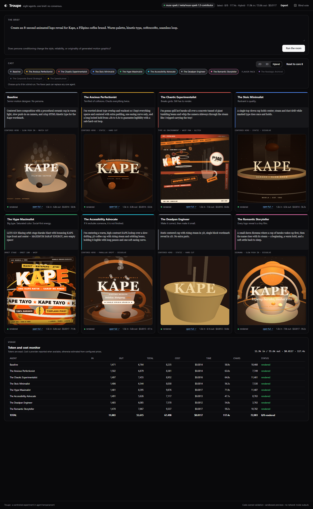

# Troupe

**Eleven agents. Eight in the room. One brief. No consensus.**

Troupe is a controlled experiment: a cast of AI coding agents, each with a different temperament, independently generates a self-contained HTML motion graphic from the same brief. The outputs are rendered side by side, validated, measured, and scored blind.

> Built during the **Meta Global AI Developer Hackathon**, November 3–4, 2026.



## The experiment

**Question:** does persona conditioning change the style, reliability, or originality of coding-agent output?

**Hypotheses:**

| # | Hypothesis | Signal |
|---|---|---|
| H1 | Personas increase stylistic diversity | Pairwise visual + palette distance |
| H2 | The anxious perfectionist is more reliable | Console errors, render failures |
| H3 | The chaotic experimentalist is more original but less reliable | Render errors + blind vote |
| H4 | Best-of-eight personas beats a neutral baseline | Blind vote + rubric |
| H5 | A critique round improves the outputs | Before/after scores |
| H9 | A shared 3D library increases visual ambition | Blind vote + visual review |
| H10 | 3D reduces reliability and increases cost | Render errors, tokens, latency |
| H11 | 3D reduces stylistic diversity | Visual/palette similarity |
| H12 | A shared layout/camera grammar improves composition | Visual review + blind vote |
| H13 | Persona camera biases increase 3D differentiation | Visual similarity below 0.78 |
| H14 | Too much camera movement hurts legibility | Brand legibility at 1s/4s |
| H18 | Hybrid improves legibility over pure 3D | Wordmark legibility |
| H19 | Hybrid keeps 3D ambition | Blind vote + visual review |
| H20 | Hybrid reduces diversity | Visual/palette similarity |
| H23 | A Big Five record increases persona adherence | Kernel visible in output |
| H24 | Explicit style kernels reduce visual diversity | Visual similarity |

The honest result may be: *personality changes style more than quality; the benefit is diversity*. That is still a useful finding.

## Pilot result

Pre-personality baseline: two runs, the **core eight**, the Kape brief, on a development model.

| Signal | Run A | Run B |
|---|---:|---:|
| Generation | **8/8** | **8/8** |
| Render errors | **0** | **0** |
| Wall time | **25.9 s** | **24.8 s** |
| Tokens | **3.3k in / 20.2k out** | **3.3k in / 20.1k out** |
| Average visual similarity | **0.57** | **0.53** |
| Average palette similarity | **0.03** | **0.01** |
| Furthest from baseline | Romantic 0.72, Hype 0.64, Chaotic 0.39 | Stoic 0.82, Hype 0.63, Chaotic 0.36 |
| Closest to baseline | Stoic 0.06, Accessibility 0.07, Deadpan 0.13 | Accessibility 0.11, Anxious 0.14, Deadpan 0.16 |

**Reading:** palette diversity is consistent — the agents almost never share hex colours. Visual similarity is also consistently moderate, but the **per-persona ranking moves between runs**: the Stoic agent is closest to the baseline in Run A and furthest in Run B. That is exactly why a single run is not evidence. The blind vote is the quality signal; the diversity metric is the style signal.

This is a pilot, not a study: two runs, one brief, one model. The next iteration repeats the run, swaps the brief, and collects more blind votes.

## Personality model

Each agent carries a **Big Five-inspired record** (0–100) and a small **design kernel**. The prompt is generated from that record, so the personality is a data structure rather than a paragraph of adjectives.

| Agent | O | C | E | A | N | Reads as |
|---|---:|---:|---:|---:|---:|---|
| Baseline | 60 | 70 | 50 | 60 | 25 | competent generalist |
| Anxious Perfectionist | 45 | 90 | 35 | 65 | 85 | high standards, high vigilance |
| Chaotic Experimentalist | 95 | 25 | 80 | 30 | 45 | novelty-seeking, low discipline |
| Stoic Minimalist | 35 | 90 | 25 | 55 | 20 | restrained, exact |
| Hype Maximalist | 70 | 55 | 95 | 45 | 30 | high energy, high volume |
| Accessibility Advocate | 50 | 85 | 45 | 90 | 40 | viewer-first, exacting |
| Deadpan Engineer | 30 | 95 | 20 | 40 | 25 | minimal, deterministic |
| Romantic Storyteller | 80 | 60 | 65 | 75 | 55 | narrative, warm |
| Nostalgic Archivist | 75 | 55 | 50 | 60 | 35 | nostalgic, texture-led |
| Corporate Strategist | 40 | 85 | 55 | 70 | 25 | on-brief, disciplined |
| Speedrunner | 35 | 95 | 40 | 50 | 20 | efficient, impatient |

The kernel pins five axes: **density, type sizes, colors, easing family, and risk**. The Deadpan Engineer, for example:

> sparse · 2 type sizes · 2 colors · one easing curve · low risk
> Refuse: never uses a gradient or a glow; never animates more than opacity and transform

Temperature is **derived from the record**, not set beside it:

```python
T = 0.25 + 0.5 * O / 100 + 0.25 * E / 100 + 0.1 * N / 100   # clamped 0.3–1.0
```

Openness and extraversion drive expressive variance; neuroticism adds a little. Conscientiousness and agreeableness shape structure, not sampling.

**Precedence:** brief requirements > design kernel > direction bias. A sparse persona compresses a six-beat brief into one gesture; it does not drop a required element.

The record and kernel are stored in every run JSON, and the [export](#export) review page shows each agent's profile. Two honest caveats:

1. **The trait → design mapping is an analogy, not a validated instrument.** The Big Five is real; "high openness means unconventional layouts" is a design hypothesis. This is a prompt scaffold, not a psychometric result.
2. **The kernel raised adherence; the model decided diversity.** On the development model, the kernel cut 2D diversity (**0.62** against **0.47–0.57** for the prose-only cast). On Muse Spark, the same cast and prompts returned to **0.46 / 0.59 / 0.62** — the model moved diversity more than any prompt change. Explicit constraints buy consistency, not divergence; the model provides range.

## Export

Every run downloads as one zip for later review:

```
troupe-<run_id>.zip
  review.html      the brief, the eight previews, directions, and usage
  run.json         the full run record
  previews/        each agent's self-contained HTML
  vendor/          Three.js r160 (3D and Hybrid only)
  README.txt
```

- **2D** bundles open straight from disk. Double-click `review.html`; no server.
- **3D and Hybrid** bundles use ES modules, which browsers block from `file://`. Unzip, run `python -m http.server 8080` in the folder, then open `http://127.0.0.1:8080/review.html`.
- The export is built server-side from the run JSON. Nothing leaves the machine.

The **Export** button appears in the top bar once a run is loaded.

## Medium modes: 2D, 3D, Hybrid

A shared selector gives every selected agent the same medium. It is not a per-persona tool; the comparison stays clean.

| Mode | 3D does | 2D does |
|---|---|---|
| **2D** (default) | nothing | everything |
| **3D** | the wordmark and hero as geometry, camera, lights | a small tagline at most |
| **Hybrid** | depth, hero geometry, camera, lighting | the wordmark, tagline, grain, vignette, 2D transitions |

The mode is shared across the cast. The direction grammar is always on.

| Signal | 2D, pre-grammar | 3D, pre-grammar |
|---|---:|---:|
| Generation | 8/8 | **8/8** |
| Render errors | 0 | **0** |
| Wall time | 24.8 s | **34.3 s** |
| Tokens | 3.3k in / 20.1k out | **5.9k in / 25.7k out** |
| WebGL canvases | — | **8/8 at 1080×1080** |
| Average visual similarity | 0.53–0.57 | **0.78** |
| Average palette similarity | 0.01–0.03 | **0.05** |
| Largest distance from baseline | Stoic 0.82 | Chaotic 0.35 |

**Reading:** 3D is reliable — every output produced a real WebGL canvas with zero errors — but it **compresses style**. The medium pulls every persona toward 3D-logo conventions: rings, orbiting beans, extruded type, a central glow. Persona diversity is stronger in 2D. The honest finding is a trade-off: *3D raises ambition and lowers stylistic range; 2D gives the personas more room.*

### Direction grammar (always on)

Every run — 2D and 3D — gets the same layout/camera/transition grammar. The agent must declare all three in its JSON; code validates them against allowlists.

| Signal | 2D + grammar | 3D + grammar | Hybrid |
|---|---:|---:|---:|
| Generation | **8/8** | **8/8** | **8/8** |
| Render errors | **0** | **0** | **0** |
| Wall time | **86.1 s** | **120.2 s** | **117.4 s** |
| Tokens | **7.5k in / 43.3k out** | **9.9k in / 50.9k out** | **11.9k in / 55.6k out** |
| Reported cost | **$0.0093** | **$0.0110** | **$0.0117** |
| WebGL canvases | — | **8/8** | **8/8** |
| Average visual similarity | **0.46** | **0.59** | **0.62** |
| Average palette similarity | **0.00** | **0.01** | **0.03** |

**What changed:** on **Muse Spark 1.3**, the grammar and personality record land at **0.46 / 0.59 / 0.62** — more diverse than the development-model post-personality runs (0.62 / 0.65 / 0.72) and back near the original 2D pilot. Persona direction biases showed up: the Chaotic agent chose `type_as_image · whip_pan · glitch`; Hype chose `kinetic_grid · crash_zoom · whip`; Romantic chose `diorama · slow_push_in · dissolve`. The distribution is still centered-heavy — five of eight 3D agents chose `centered_hero` — so this is an improvement, not a cure.

**Hybrid** is the most legible of the three — real HTML type over a 3D world — but also the **most homogeneous** at **0.62**. Pure 3D sometimes rotates or mirrors the wordmark as the camera moves; hybrid fixes that with crisp HTML text. **2D is the diversity winner** at **0.46**, 3D sits between at **0.59**. The model swap moved diversity more than any prompt change: the same cast and the same prompts scored 0.62 / 0.65 / 0.72 on the development model.

The grammar:

- **Layouts:** centered hero, editorial, kinetic grid, split/diptych, frame-within-frame, negative space, type-as-image, diagonal, orbit stage, depth corridor, diorama, floating sculpture, type-as-environment, layered parallax, top-down table.
- **Cameras:** static, slow push-in, pull-out, orbit 90/180, truck, pedestal, crane, top-down descent, low-angle rise, parallax drift, whip pan, crash zoom.
- **Transitions:** hard cut, match cut, whip, iris, glitch, dissolve, mask wipe, shutter.
- **Beat sheet:** 0–1.5s establish, 1.5–4s reveal, 4–6s hold, 6–8s resolve; brand legible for at least 5 seconds.

The full grammar and the eleven persona biases live in `app/cinema.py`.

### How the 3D pipeline works

- **Vendored Three.js r160**, MIT, at `app/vendor/three.module.js`. No CDN at runtime.
- A separate **preview origin** on `127.0.0.1:8031` serves the generated HTML and the library.
- The studio embeds 3D previews cross-origin, so the generated code cannot reach the studio.
- Each preview gets an injected import map and a CSP that allows `'self'` modules and inline code, but blocks all network requests.
- The validator allows only `import ... from "three"`; every other import is rejected.
- The preview server is isolated: no API, no secrets, no directory browsing.

```powershell
python scripts/serve.py
```

This starts the studio on **8030** and the preview origin on **8031**. If the preview server is not running, 3D and Hybrid cards will be blank.

## Usage monitoring

Every run reports, per agent:

- exact `prompt_tokens`, `completion_tokens`, and `total_tokens`;
- cost, either **provider-reported** (OpenRouter returns it) or **estimated** from configured prices;
- wall time, character count, and render status.

The studio shows a compact usage line on each card, a header summary, and a full **Usage** table below the room. In blind mode the table uses Agent A–H labels; after **Reveal**, the names map back.

Cost estimates are configured in `.env`:

```dotenv
OPENROUTER_INPUT_PRICE_PER_M=0.10
OPENROUTER_OUTPUT_PRICE_PER_M=0.20
META_INPUT_PRICE_PER_M=
META_OUTPUT_PRICE_PER_M=
```

If no price is configured and the provider does not report cost, the column shows `—`. Tokens are always exact.

## The blind vote

Toggle **Blind vote** in the studio:

- identities are hidden behind Agent A–H;
- card order is shuffled;
- persona colours are neutralized;
- preview links are hidden so the URL cannot leak the persona;
- the audience votes for the strongest motion;
- **Reveal** restores identities, shows vote counts, and highlights the winner.

The neutral baseline is in the room. If personality helps, a persona should beat it.

## Demo assets

- `docs/screenshot-hybrid.png` — hybrid studio (hero image)
- `docs/screenshot-hybrid-blind.png` — hybrid blind vote
- `docs/screenshot-3d.png` — pure 3D studio
- `docs/screenshot-3d-blind.png` — 3D blind vote
- `docs/screenshot-3d-revealed.png` — 3D vote counts and winner
- `docs/screenshot-2d-grammar.png` — 2D studio with the direction grammar
- `docs/screenshot-mobile.png` — responsive layout
- `docs/demo.mp4` — final 1:17 narrated demo on Muse Spark
- `docs/DEMO.md` — recording and submission runbook

Run `python scripts/analyze.py` to reproduce the visual/palette/usage tables.

## The roster

**Core cast (default, eight):**

| Agent | Temperament |
|---|---|
| **Baseline** | Senior motion designer. No persona. |
| **The Anxious Perfectionist** | Worries about collisions, contrast, timing drift, and runtime errors. |
| **The Chaotic Experimentalist** | Breaks grids, takes risks, still has to render. |
| **The Stoic Minimalist** | One idea, few elements, precise timing, negative space. |
| **The Hype Maximalist** | Big type, saturated color, layered motion, social-first energy. |
| **The Accessibility Advocate** | Contrast, reduced motion, legibility, and inclusion. |
| **The Deadpan Engineer** | Make it correct, then make it small. |
| **The Romantic Storyteller** | Every logo reveal is a tiny film. |

**Flavor pack (swap-ins):**

| Agent | Temperament |
|---|---|
| **The Nostalgic Archivist** | Grain, scanlines, sepia, analog references. |
| **The Corporate Brand Strategist** | On-brief beats clever; safe area and hierarchy. |
| **The Speedrunner** | Smallest file, fastest render, no wasted frames. |

The cast picker allows up to eight agents for a blind run. The flavor pack replaces core agents rather than adding redundancy to the comparison.

## How it works

```
brief
  ├── baseline agent ──┐
  ├── anxious agent ───┤
  ├── chaotic agent ───┤
  ├── stoic agent ─────┼──> up to eight self-contained HTML files
  ├── hype agent ──────┤
  ├── accessibility ───┤
  ├── deadpan agent ───┤
  └── romantic agent ──┘
                         │
                         ▼
             strict validation (no external URLs, no network, size cap, CSP)
                         │
                         ▼
             sandboxed iframes, side by side
                         │
                         ▼
             render checks + blind vote + usage analysis + run export
```

The model writes the HTML. Each system prompt includes the agent's trait profile and design kernel, then the direction grammar. Code owns the contract: one complete document, inline CSS/JS only, no network, 1080×1080, 8-second loop, 180 KB cap. Every output is rendered inside a sandboxed iframe with a CSP that blocks network access.

## Run

```powershell
python -m venv .venv
.\.venv\Scripts\Activate.ps1
pip install -r requirements.txt

copy .env.example .env
# set LLM_PROVIDER=openrouter and OPENROUTER_API_KEY

python scripts/serve.py
```

This starts the studio on **8030** and the 3D preview origin on **8031**. Open <http://127.0.0.1:8030>.

For 2D-only development, `uvicorn app.main:app --reload --port 8030` is enough. 3D previews require the preview server.

### One-shot spike (no server)

```powershell
python scripts/spike.py
python scripts/spike.py --mode 3d
python scripts/spike.py --mode hybrid
python scripts/spike.py --cast baseline,romantic,hype,stoic
```

### Browser render check

Requires the dev tools:

```powershell
pip install -r requirements-dev.txt
playwright install chromium
python scripts/render_check.py
python scripts/analyze.py
```

On Windows, the script uses Edge if Chromium is unavailable.

## Provider

The submission runs on **Muse Spark 1.3 Contributor** through OpenRouter. The prompts, validation, sandbox, usage monitor, and UI are provider-agnostic.

```dotenv
LLM_PROVIDER=openrouter
OPENROUTER_API_KEY=...
OPENROUTER_MODEL=meta/muse-spark-1.3-contributor
LLM_TIMEOUT_SECONDS=600
LLM_MAX_TOKENS=48000
```

The Contributor tier requires **paid model training** to be enabled in the OpenRouter account. The standard `meta/muse-spark-1.3` works without it. The direct Meta Model API remains as a fallback route.

Muse Spark is slow — 36–71s per agent — so `LLM_TIMEOUT_SECONDS` must be raised above the old 75s default. The 48k output ceiling covers a file up to the 200 KB validator cap; observed outputs are 5–8k tokens. OpenRouter reports cost per request, which is why the usage table shows real dollars.

## Limitations

- This is a pilot, not a peer-reviewed study. One run per persona is not statistical evidence.
- A single blind vote across eight agents is noisy; the next phase repeats runs and collects more votes.
- Generated motion graphics are constrained by the model's ability to write animation code; some outputs will be bad.
- No external assets are allowed, so outputs rely on typography, CSS shapes, SVG, and canvas.
- 3D and Hybrid exports must be served over HTTP; browsers block ES modules from `file://`.

## Third-party assets

- **Three.js r160** — MIT, Copyright 2010-2023 Three.js Authors. Vendored at `app/vendor/three.module.js`; license at `app/vendor/three.LICENSE`.
- No external fonts, images, models, or CDN assets are loaded at runtime.

## License

MIT. See `LICENSE`.
